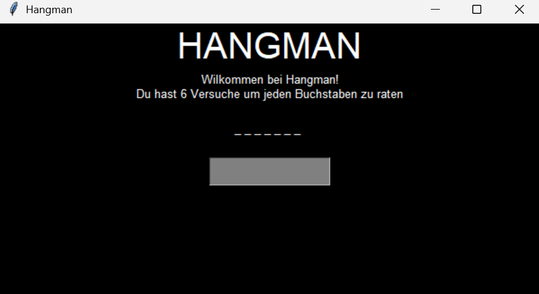

# Hangman

Ein Hangman-Spiel mit grafischer Oberfläche, geschrieben in Python und Tkinter. Errate das zufällig ausgewählte Wort Buchstabe für Buchstabe, bevor dir die Versuche ausgehen.



## Voraussetzungen

- Python 3 
- Tkinter

Unter Linux kann Tkinter je nach Distribution separat installiert werden. Falls beim Start ein Fehler zu `tkinter` erscheint, installiere das Tkinter-Paket deiner Distribution.

## Starten

Speichere `Hangman.py` und `Woerter.txt` im selben Ordner. Öffne ein Terminal in diesem Ordner und starte das Spiel mit oder öffne Hangman.py:

```bash
python Hangman.py
```

Auf manchen Systemen lautet der Befehl stattdessen `python3 Hangman.py`.

## Spielen

1. Das Spiel zeigt das gesuchte Wort zunächst als Unterstriche an.
2. Gib einen Buchstaben in das Eingabefeld ein und drücke Enter.
3. Richtige Buchstaben werden im Wort aufgedeckt. Bei einem falschen Buchstaben verlierst du einen Versuch.
4. Bereits geratene Buchstaben, leere Eingaben und Eingaben mit mehr als einem Zeichen werden nicht als Fehlversuch gezählt.
5. Errätst du das Wort oder sind alle Versuche aufgebraucht, kannst du eine neue Runde starten oder das Fenster schließen.

## Wörter anpassen

Die Wörter stehen in `Woerter.txt`. Du kannst auch deine eigenen hinzufügen. Trenne sie dann durch Kommas (","). Beispiel:

```text
Apfel,Baum,Python,Computer
```

Die Datei wird als UTF-8 gelesen. Achte darauf, dass sie neben `Hangman.py` liegt und mindestens ein Wort enthält.

## Einstellungen

In `Hangman.py` kannst du die Anzahl der Versuche über `VERSUCHE` ändern. Standardmäßig sind es sechs.

Mit `WORT` lässt sich optional ein festes Wort vorgeben. Bei `WORT = None` wählt das Spiel ein zufälliges Wort aus der Wortdatei (Woerter.txt).


## Lizenz

Dieses Projekt steht unter der MIT License.
Weitere Informationen findest du in der Datei [LICENSE](LICENSE).

© 2026 Tarekthedev
