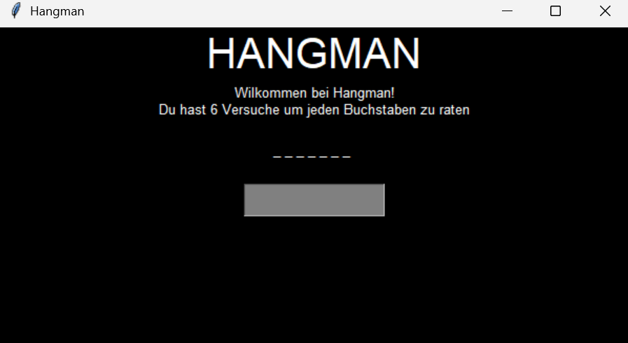

# Hangman

<a href="#english">English</a> | <a href="#deutsch">Deutsch</a>




## English

A Hangman game with a graphical interface, written in Python and Tkinter. Guess the randomly selected word one letter at a time before you run out of attempts.

### Download (.zip with executable for Windows)
<a href="https://github.com/Tarekthedev/Hangman/releases/download/v1.0.0/Hangman_exe.zip">

</a>

**Installation:**

1. Click the download button.
2. Save `Hangman_exe.zip` and extract its contents.
3. Customize `assets/settings.json` and `assets/words.txt` if desired.
4. Run `Hangman.exe` and have fun!

### Run the game using Python

Open a terminal in the project directory and run:

```bash
python Hangman.py
```

On some systems, use `python3 Hangman.py` instead.

### How to play

1. The game displays the hidden word as underscores.
2. Enter a letter in the input field and press Enter.
3. Correct letters are revealed in the word. Each incorrect guess costs one attempt.
4. Previously guessed letters, empty input, and entries containing more than one character do not count as incorrect guesses.
5. Once you guess the word or run out of attempts, you can start a new round or close the window.

### Customize the word list

The words are stored in `assets/words.txt`. You can add your own words, separated by commas. For example:

```text
Apple,Tree,Python,Computer
```

The file is read as UTF-8. Keep it in assets and make sure it contains at least one word.

### Settings (assets/settings.json)
| Setting | What it does | Values |
| --- | --- | --- |
| `MAX_ATTEMPTS` | Sets the number of attempts per round. | Any positive number; default: `6` |
| `WORD` | Uses a fixed word instead of choosing one at random. | `null` for a random word, or a word in quotation marks; default: `null` |
| `WORD_FILE` | Selects the file containing the words. | A file name; default: `"words.txt"` |
| `LANGUAGE` | Selects the language used by the interface. | `"en"` for English, `"de"` for German, or `"es"` for Spanish; default: `"en"` |
| `LANGUAGE_FILE` | Selects the file containing the interface text. | A file name; default: `"languages.json"` |

### Licence

This project is distributed under the MIT Licence. See [LICENSE](LICENSE) for details.

© 2026 Tarekthedev


## Deutsch

Ein Hangman-Spiel mit grafischer Oberfläche, geschrieben in Python und Tkinter. Errate das zufällig ausgewählte Wort Buchstabe für Buchstabe, bevor dir die Versuche ausgehen.

### Download (.zip mit .exe für Windows)
<a href="https://github.com/Tarekthedev/Hangman/releases/download/v1.0.0/Hangman_exe.zip">

</a>

**Installation:**
1. Klicke auf den Download-Button.
2. Speichere `Hangman_exe.zip` und entpacke die Datei.
3. Passe `assets/settings.json` und `assets/words.txt` bei Bedarf an.
4. Starte `Hangman.exe` und viel Spaß beim Spielen!

### Starten

Öffne ein Terminal in diesem Ordner und starte das Spiel mit:

```bash
python Hangman.py
```

Auf manchen Systemen lautet der Befehl stattdessen 
```bash
python3 Hangman.py
```

### Spielen

1. Das Spiel zeigt das gesuchte Wort zunächst als Unterstriche an.
2. Gib einen Buchstaben in das Eingabefeld ein und drücke Enter.
3. Richtige Buchstaben werden im Wort aufgedeckt. Bei einem falschen Buchstaben verlierst du einen Versuch.
4. Bereits geratene Buchstaben, leere Eingaben und Eingaben mit mehr als einem Zeichen werden nicht als Fehlversuch gezählt.
5. Errätst du das Wort oder sind alle Versuche aufgebraucht, kannst du eine neue Runde starten oder das Fenster schließen.

### Wörter anpassen

Die Wörter stehen in `assets/words.txt`. Du kannst auch deine eigenen hinzufügen. Trenne die Wörter durch Kommas (","). Beispiel:

```text
Apfel,Baum,Python,Computer
```

Die Datei wird als UTF-8 gelesen. Achte darauf, dass sie mindestens ein Wort enthält.

### Einstellungen (`assets/settings.json`)
| Funktion | Was sie macht | Werte |
| --- | --- | --- |
| `MAX_ATTEMPTS` | Legt die Anzahl der Versuche pro Runde fest. | Jede positive Zahl; Standard: `6` |
| `WORD` | Verwendet ein festes Wort, statt zufällig eines auszuwählen. | `null` für ein zufälliges Wort oder ein Wort in Anführungszeichen; Standard: `null` |
| `WORD_FILE` | Legt die Datei mit den Wörtern fest. | Ein Dateiname; Standard: `"words.txt"` |
| `LANGUAGE` | Legt die Sprache der Benutzeroberfläche fest. | `"en"` für Englisch, `"de"` für Deutsch oder `"es"` für Spanisch; Standard: `"en"` |
| `LANGUAGE_FILE` | Legt die Datei mit den Texten der Benutzeroberfläche fest. | Ein Dateiname; Standard: `"languages.json"` |

### Lizenz

Dieses Projekt steht unter der MIT License. Weitere Informationen sind in der Datei [LICENSE](LICENSE).

© 2026 Tarekthedev
